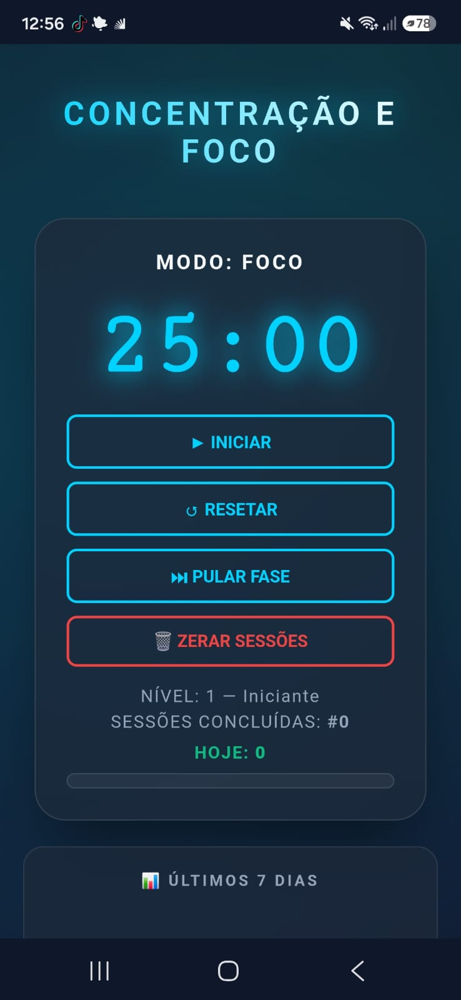

# Concentração e Foco | Pomodoro Timer

**A Pomodoro timer with a dark terminal look, XP levels and a weekly history chart, built with plain HTML, CSS and JavaScript (no libraries, no framework). Installable as a PWA and works offline.**

🌐 **Live demo:** [carlosdanidev.github.io/pomodoro](https://carlosdanidev.github.io/pomodoro/)

<!-- Add screenshots to a /docs folder and update the paths below -->
<p align="center">
  
  
</p>

> **Status:** working and in active use. I use it every day to study.

## Features

- Full Pomodoro cycle: 4 focus sessions with short breaks, then a long break.
- Configurable focus, short break and long break times (saved in the browser).
- **Skip phase** without counting the session or XP.
- **Keyboard shortcuts:** `Space` starts/pauses and `S` skips the phase.
- Gamification: XP, levels (every 10 sessions) and a daily session counter.
- **Last 7 days history** as a bar chart.
- End-of-phase alerts: sound alarm, system notification and remaining time in the tab title.
- The screen stays on while the timer runs (Wake Lock API).
- Reloading or closing the page doesn't lose the current phase, paused or running.
- **PWA:** can be installed on the home screen and opens offline.

## Tech stack

- **HTML5 / CSS3:** structure and responsive layout
- **JavaScript (ES6+):** timer logic, state and UI
- **Web APIs:** Wake Lock, Notifications, Page Visibility, Web Audio, LocalStorage, Service Worker
- **PWA:** Web App Manifest + Service Worker

## Technical decisions

1. **Counting with the real clock, not "minus 1 every second".** The timer stores the time the phase ends (`Date.now()`) and recalculates the remaining time on every tick. If the tab goes to the background and the browser slows down `setInterval`, the displayed time is still correct when you come back.
2. **Phase state saved as a single object in `localStorage`** (phase, remaining time and end time). On reload, the app restores the right phase. If the time ran out while the page was closed, the phase restarts and the session is **not** counted.
3. **Audio unlocked on the "Start" click.** Browsers block sound created without a user gesture, and the alarm plays at the end of the timer, when there is no click. So the `AudioContext` is prepared on the first click and reused.
4. **Notifications through the Service Worker.** On Chrome for Android, `new Notification()` throws an error; the notification must be sent with `registration.showNotification()`. The code tries the Service Worker first and falls back to the constructor.
5. **"Network first, cache as fallback" Service Worker.** Online, it always serves the newest files; offline, it opens the last cached version.
6. **History without a backend.** Each day is a `localStorage` key (`pomodoro-YEAR-MONTH-DAY`); the chart reads the last 7 days, and records older than 30 days are deleted.
7. **Alarm generated with the Web Audio API**, with no audio file and no dependency.
8. **Safe `localStorage` access.** Reads are wrapped in `try/catch` and values are validated: in private mode it can throw, and corrupted settings fall back to the defaults instead of breaking the timer.
9. **Accessibility:** modal with focus trap and `Esc` to close, `aria-live` announcements, a text summary of the chart for screen readers, visible keyboard focus and support for `prefers-reduced-motion`.

## Known limitations

- **Background tab or locked screen:** the browser may delay the alarm and the notification, because the code only runs while the page is active. The displayed time is correct when you return. The PWA improves this (installable, offline, reliable notifications on Android), but can't guarantee an on-time alert with the screen locked.
- Progress is saved only in the browser of the device being used: no account and no sync.

## Running locally

```bash
git clone https://github.com/CarlosdaniDev/pomodoro.git
cd pomodoro
```

Open `index.html` with a local server (for example, the VS Code **Live Server** extension). A server is needed because Service Workers don't run from `file://`.

## What I learned

- **Browsers don't run timers reliably in the background.** In an earlier version, the timer froze when the tab was in the background. Storing the end time and recalculating the remaining time on every tick fixed it.
- **Browser autoplay rules:** sound needs a user gesture, which changed how I set up the audio.
- **Platform differences matter:** on Chrome for Android, notifications have to be sent through the Service Worker (`registration.showNotification()`), so the code tries that first and falls back to the standard API.
- **Handling failure cases:** `localStorage` can throw or hold bad data, so the app validates everything it reads.
- **Accessibility is part of the job:** focus management, `aria-live` and reduced-motion support.

## Roadmap

- [ ] Rank system
- [ ] Automated tests for the timer logic
- [ ] Export history

---

### 🇧🇷 Em português

Cronômetro Pomodoro com visual de terminal, XP, níveis e histórico semanal, feito em HTML, CSS e JavaScript puros. Pode ser instalado como app (PWA) e funciona offline. Acesse: [carlosdanidev.github.io/pomodoro](https://carlosdanidev.github.io/pomodoro/)

---

Built by **Carlos Daniel**, Systems Analysis and Development student · [GitHub](https://github.com/CarlosdaniDev) · [LinkedIn](https://www.linkedin.com/in/carlos-daniel-5b49b11b2)
